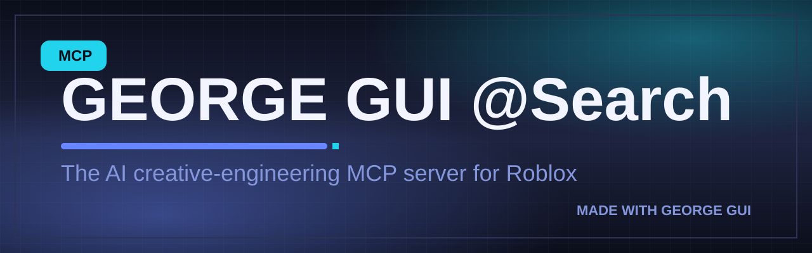

<p align="center">
  
</p>

<h1 align="center">GEORGE GUI @Search</h1>

<p align="center">
  <strong>The AI creative-engineering MCP server for Roblox.</strong><br>
  <em>Build beyond imagination.</em>
</p>

<p align="center">
  <a href="https://www.npmjs.com/package/george-gui-search"></a>
  <a href="https://github.com/renniyy/george-gui-search/actions/workflows/ci.yml"></a>
  <a href="https://www.npmjs.com/package/george-gui-search"></a>
  <a href="./LICENSE"></a>
  
</p>

---

**GEORGE GUI @Search** is a [Model Context Protocol](https://modelcontextprotocol.io) server that turns natural language into production-grade Roblox interfaces: complete, self-contained Luau UI modules with theme tokens, animations, responsive layout and a controller API — every one audited for contrast, touch targets and text sizes **before it is returned**.

It is not an image-generation wrapper. Every artifact that comes out of George is real, editable, standards-checked code:

```text
"a neon shop with tabs and item cards"
        │
        ▼  george_generate_gui
┌─────────────────────────────────────────────┐
│  ShopUI.module.lua                          │
│  ├─ --!strict (typechecks under luau-lsp)   │
│  ├─ Theme tokens (WCAG-validated palette)   │
│  ├─ Full instance hierarchy                 │
│  ├─ Tween animations + gamepad focus        │
│  ├─ Controller API (mount/open/on/setItems) │
│  └─ Self-critique audit: 100/100 ✓          │
└─────────────────────────────────────────────┘
```

## Why George

| | GEORGE GUI @Search |
| --- | --- |
| **Audited by default** | WCAG contrast math, 36 px touch targets, minimum text sizes, responsive checks — every generation is scored, and every palette/kind combination ships at 100/100 (verified by 144 test cases). |
| **Really runs** | Generated modules are valid `--!strict` Luau, parse under the real StyLua 2 formatter, and pass George's own Roblox-specialised static analysis with zero errors. |
| **Design systems, not vibes** | Six curated palettes with light/dark variants, 4 px spacing grid, type scale, radius and motion scales — emitted as a Luau `Theme` table and JSON. |
| **Security-first patterns** | The Luau templates (secure rate-limited remotes, retrying DataStore profiles, signals) are the kinds of code production games need, and the review engine flags unprotected DataStore calls, unvalidated remotes, frozen loops and more. |
| **Offline-first** | Zero network calls required. The research knowledge base, pixel thumbnail renderer and all generators run locally. Optional adapters (ComfyUI, any OpenAI-compatible image API, changedetection.io…) activate via environment variables. |

## Install

Requirements: **Node.js ≥ 20** and any MCP client (Claude Desktop, VS Code, Cursor, Zed…).

```bash
npx george-gui-search
```

Or add it to your MCP client configuration (see [docs/INSTALLATION.md](docs/INSTALLATION.md) for every client):

```json
{
  "mcpServers": {
    "george-gui-search": {
      "command": "npx",
      "args": ["-y", "george-gui-search"]
    }
  }
}
```

## The tool suite

| Tool | Engine | What it does |
| --- | --- | --- |
| `george_search` | George Research | Source-linked Roblox/MCP knowledge search (43 verified entries, all with official URLs). |
| `george_design_system` | George Designer | Emit a full design token system (Luau Theme module + JSON), or list palettes. |
| `george_generate_gui` | George Builder | Natural language → complete Roblox interface module (12 interface kinds). |
| `george_audit_gui` | George Inspector | Re-run the self-critique audit on any generated GuiSpec. |
| `george_generate_luau` | George Engineer | Production script templates: secure remotes, DataStore profiles, signals. |
| `george_review_luau` | George Engineer | Roblox-specialised static analysis of your Luau. |
| `george_project_scaffold` | George Architect | Rojo + Rokit + Wally + StyLua + Selene project scaffold. |
| `george_generate_thumbnail` | George Designer | Offline pixel-art thumbnail PNG + SVG banner; optional external image providers. |
| `george_integrations` | George Marketplace | Honest, live-probed status of the integration ecosystem. |
| `george_version` | — | Version and capability report. |

Full schemas and examples: [docs/MCP_TOOLS.md](docs/MCP_TOOLS.md).

## Interface kinds

`main-menu` · `shop` · `inventory` · `settings` · `hud` · `loading-screen` · `leaderboard` · `notifications` · `dialogue` · `quest-tracker` · `profile-card` · `custom` — auto-detected from your description, or forced explicitly.

Every generated module shares the same controller pattern:

```lua
local ShopUI = require(game.ReplicatedStorage.Shared.ShopUI)

local ui = ShopUI.mount()
ui:open()
ui:on("buy", function(item)
  print("Player wants to buy", item.name, "for", item.price)
end)
ui:setItems({
  { name = "Plasma Blade", subtitle = "Weapon", price = "750", badge = "NEW" },
})
```

## Example session

> **You:** Use george_generate_gui to build "a royal arcade profile card for the winner, light mode".
>
> **George:** returns `ProfileCardUI` — a single ModuleScript with the Royal Arcade light design system, avatar slot, stat grid, badge row, VIEW PROFILE action, hover/press/gamepad feedback, entrance animation — and its audit report: 12 contrast checks passed, all touch targets ≥ 36 px, score 100/100.

Try it yourself in 60 seconds with the [quickstart](docs/GETTING_STARTED.md) or the [MCP Inspector](https://github.com/modelcontextprotocol/inspector):

```bash
npx @modelcontextprotocol/inspector npx george-gui-search
```

## Configuration

George is zero-config. Optional environment variables activate adapters (see [docs/CONFIGURATION.md](docs/CONFIGURATION.md)):

| Variable | Activates |
| --- | --- |
| `GEORGE_IMAGE_API_URL` + `GEORGE_IMAGE_API_KEY` (+ `GEORGE_IMAGE_MODEL`) | Any OpenAI-compatible image API for thumbnails |
| `GEORGE_COMFY_URL` (+ `GEORGE_COMFY_CHECKPOINT`) | A local ComfyUI instance for thumbnails |
| `GEORGE_SCRAPLING_URL` | A Scrapling extraction sidecar (see `examples/integrations/scrapling_sidecar.py`) |
| `GEORGE_AGENT_REACH_URL` | An Agent-Reach service for extended research reach |
| `GEORGE_BROWSER_USE_URL` | A browser-use server for authorised browser workflows |
| `GEORGE_CHANGEDETECTION_URL` (+ `GEORGE_CHANGEDETECTION_API_KEY`) | changedetection.io doc/dependency watch management |

Unset variables never break anything — features degrade gracefully and `george_integrations` reports exactly what is active.

## Architecture

```text
┌─────────────────────────── MCP client (Claude / VS Code / Cursor / …) ─────────────────────────┐
│                                                                                                 │
│                          stdio · Model Context Protocol · @modelcontextprotocol/sdk             │
└───────────────────────────────────────────────┬────────────────────────────────────────────────┘
                                                │
┌─────────────────────────────── src/server.ts (10 validated tools) ─────────────────────────────┐
│                                                                                                │
│   core/gui-generator   intent → GuiSpec IR → Luau emission (kinds-a/kinds-b + shell)           │
│   core/tokens          6 palettes × light/dark, WCAG-solved by scripts/adjust-palettes.mjs     │
│   core/audit           self-critique: contrast math, touch targets, text sizes, responsive     │
│   core/luau-review     Roblox static analysis (deprecated APIs, unprotected DataStore, …)      │
│   core/luau-templates  secure-remotes · profile-store · signal                                 │
│   core/luau-text       canonicalizer (tab indent, one prop per line — StyLua-clean output)     │
│   core/knowledge       verified, source-linked research index                                  │
│   core/image           offline pixel renderer + SVG composer + provider adapters               │
│   core/png             dependency-free PNG encoder (Node zlib)                                 │
│   core/scaffold        Rojo/Rokit/Wally/StyLua/Selene project scaffolds                        │
│   integrations/        honest registry + health probes (11 mandated + ecosystem)               │
└────────────────────────────────────────────────────────────────────────────────────────────────┘
```

Details: [docs/ARCHITECTURE.md](docs/ARCHITECTURE.md) · Tool schemas: [docs/MCP_TOOLS.md](docs/MCP_TOOLS.md) · API: [docs/API_REFERENCE.md](docs/API_REFERENCE.md)

## Quality gates (all enforced by CI)

- **71 automated tests**, including a real MCP client→server protocol test over stdio
- **144 audit cases**: every interface kind × palette × mode must score 100/100
- Generated Luau passes the **real StyLua 2.0.2 formatter** with the shipped config (verified in CI-style checks) and typechecks under `--!strict`
- The review engine flags its own historical bug classes: deprecated globals, unprotected DataStore calls, unvalidated remotes, frozen loops, chat-ignoring input handlers

## Documentation

| Doc | Purpose |
| --- | --- |
| [Getting started](docs/GETTING_STARTED.md) | 60-second first generation |
| [Installation](docs/INSTALLATION.md) | Every supported MCP client |
| [Configuration](docs/CONFIGURATION.md) | Environment variables and providers |
| [User guide](docs/USER_GUIDE.md) | Recipes per interface kind |
| [Developer guide](docs/DEVELOPER_GUIDE.md) | Working on George itself |
| [Architecture](docs/ARCHITECTURE.md) | How the pipeline works |
| [MCP tools](docs/MCP_TOOLS.md) | Every tool, schema and example |
| [API reference](docs/API_REFERENCE.md) | Programmatic embedding |
| [Integrations](docs/INTEGRATIONS.md) | The integration acceptance report |
| [Security](docs/SECURITY.md) | Threat model and guarantees |
| [Troubleshooting](docs/TROUBLESHOOTING.md) | Fixes for common issues |
| [FAQ](docs/FAQ.md) | Answers |
| [Roadmap](docs/ROADMAP.md) | What's next |
| [Changelog](CHANGELOG.md) | Release history |

## Branding

The full identity — logo system, palettes, typography, mascot usage — lives in [brand/BRAND_GUIDELINES.md](brand/BRAND_GUIDELINES.md). All assets are original works shipped as editable SVG plus optimized PNG.

## Contributing

Issues and pull requests are welcome — see [CONTRIBUTING.md](CONTRIBUTING.md). Security reports follow [SECURITY.md](SECURITY.md). By participating you agree to the [Code of Conduct](CODE_OF_CONDUCT.md).

## License

[MIT](LICENSE) © 2026 renniy. Third-party integrations keep their own licenses — see [docs/INTEGRATIONS.md](docs/INTEGRATIONS.md) for the full attribution matrix.

---

<p align="center">
  
  <br>
  <em>George says: every interface you ship should be one you're proud of.</em>
</p>
